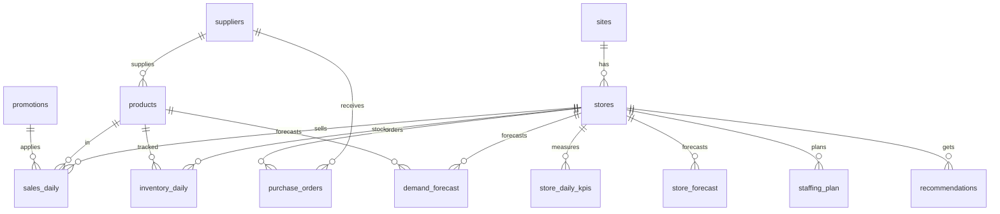

# Arquitectura

```
CSV (repo público) ─► loader (limpieza + dq_issues) ─► PostgreSQL 16 / Cloud SQL
                                                     │
                  ┌──────────────────────────────────┤
                  ▼                                  ▼
        ML (scikit-learn)                    esquema rpt (vistas) ─► Power BI
   modelo tienda + modelo SKU                         ▲
                  ▼                                   │
        motor de decisiones ─► recommendations ─► API FastAPI ─► Dashboard (HTML/CSS/JS, Liquid Glass)
                                                      └────────► Gemini (solo redacta; no calcula)
```

## Base de datos: PostgreSQL 16 (Cloud SQL en producción)
Relacional, transaccional, con vistas para BI y soporte nativo en Power BI. SQLite solo para pruebas.
DDL completo: `db/01_schema.sql` (generado con `scripts/export_schema.py`); vistas: `db/02_reporting_views.sql`.

Capas: dimensiones (`sites, stores, store_closures, suppliers, products, product_barcodes, calendar, promotions, prices, weather_daily`) →
hechos (`sales_daily, inventory_daily, purchase_orders, store_daily_kpis`) → gobernanza (`dq_issues`) →
analítica (`demand_forecast, store_forecast, staffing_plan, promo_performance, supplier_performance, model_runs`) →
decisiones (`recommendations`).



## Machine learning
`HistGradientBoostingRegressor` (pérdida Poisson), horizonte directo de 14 días con rezagos ≥14 d (sin fuga). Dos modelos: ventas diarias por tienda y demanda por tienda×SKU (demanda corregida por quiebres de stock). Clima futuro = mismo día del año anterior. Las métricas contra el pronóstico ingenuo quedan en `model_runs`.

## Motor de decisiones
Reorden (hasta nivel objetivo, z=1.28, múltiplos de caja, lead time), reducir pedido por caducidad, simulación de descuento (10–40 %) por utilidad − costo de inventario − merma, personal por ventas/hora-labor, desempeño de promociones y proveedores.

## Calidad de datos
Duplicados, huérfanos, devoluciones, unidades imputadas, centinelas, atípicos, moneda y promociones inválidas se tratan y se registran en `dq_issues` (visible en el tablero).

## Supuestos
Sueldo/hora (`WAGE_PER_HOUR`) y fugas por falta de personal son supuestos; el dataset no los trae. Cifras de impacto = estimaciones.
